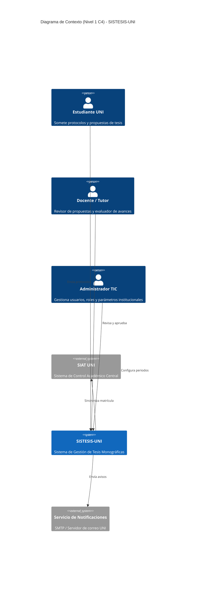
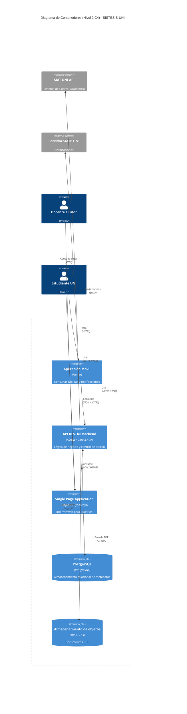
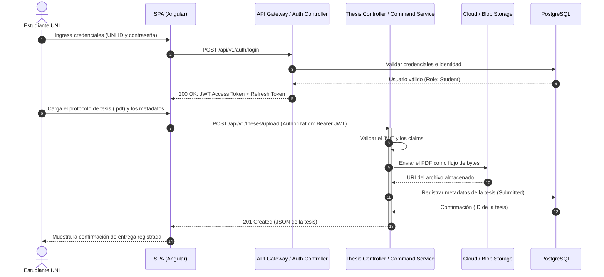

# SISTESIS-UNI

Sistema Integral de Seguimiento y Gestión de Tesis Monográficas (UNI).

## Arquitectura

### C4 Nivel 1 - Contexto

### C4 Nivel 2 - Contenedores

### Secuencia

## API

El contrato está en `openapi.yaml` (OpenAPI 3.0.3).
